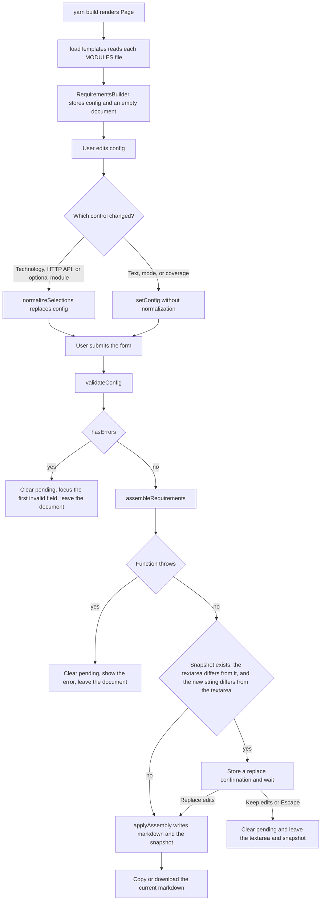

# Execution flow

Requirements Builder turns a form into one Markdown document. A user enters business requirements, chooses a mode and a technology stack, and selects Assemble Draft. The page then validates that configuration, chooses Markdown modules, and writes `PROJECT_REQUIREMENTS.md` content into an editable preview. Copy and download use the text currently in that preview.

Assembly is a synchronous, deterministic function of the current configuration and the template text loaded with the page. The same inputs always produce the same string. Nothing in that path calls an AI service, a database, or a network API. Configuration JSON import and export are not implemented.

## Main path

Changing the form does not assemble a document. Assembly runs only when the form is submitted.

## 1. Entry point and template loading

[`app/page.tsx`](../app/page.tsx) exports `Page` and `ensureStatic = "navigation"`. `Page` is a Server Component. During its render it calls `loadTemplates()` and passes the result to `RequirementsBuilder` as the `templates` prop. `ensureStatic` makes the production build fail if this route stops being fully prerendered, because a dynamic route would need to read template files at request time.

[`lib/load-templates.ts`](../lib/load-templates.ts) `loadTemplates` is synchronous. It maps `MODULES` from [`lib/module-registry.ts`](../lib/module-registry.ts) and reads each `module.file` with `fs.readFileSync` from `TEMPLATES_DIR` (`templates/` under the process working directory). The return value is a `Templates` record: module id to UTF-8 file text. A missing file throws here, so `yarn build` fails before a page is emitted. After a successful build, `yarn start` serves the prerendered page and does not read `templates/` again. [`next.config.ts`](../next.config.ts) enables `cacheComponents` and `partialPrefetching`; those settings do not change the assembly function.

[`app/layout.tsx`](../app/layout.tsx) only supplies the document shell and the page title. It does not load templates or hold form state.

Template presence, registration, and placeholder rules are checked by [`tests/templates.test.ts`](../tests/templates.test.ts). The production build is the check that `Page` still prerenders.

## 2. Configuration and document state

[`components/requirements-builder.tsx`](../components/requirements-builder.tsx) `RequirementsBuilder` is a client component. It owns the working state:

| State | Set by | Meaning |
| --- | --- | --- |
| `config` | `useState(defaultConfig)` | The form. `defaultConfig` in [`lib/config.ts`](../lib/config.ts) starts in Fast Mode with empty required text. |
| `errors` | `handleSubmit` | The latest `ValidationErrors` map. Empty until a submit. |
| `assemblyError` | `handleSubmit` | Message from a thrown assembly, or `""`. |
| `markdown` | `applyAssembly`, the textarea, or restore | The preview string, including manual edits. |
| `assembled` | `applyAssembly` | Last successful snapshot: `{ config, markdown }`, or `null` before the first success. |
| `pending` | Reassemble or Restore | A confirmation that is shown only while it still matches the live form and textarea. |
| `copyStatus` | `copyMarkdown` | `"idle"`, `"copied"`, or `"failed"`. |

Three refs are not rendered state. `copyGeneration` ignores a clipboard result that belongs to an older document. `keepEditsRef` receives focus when a confirmation opens. `downloadCount` is the in-memory download counter used when `sessionStorage` throws.

These values are derived during render and are not stored:

- `edited`: a snapshot exists and `markdown !== assembled.markdown` (exact string compare, no trim).
- `stale`: a snapshot exists and `configsMatch(config, assembled.config)` is false.
- `activePending`: `pending` only when `configsMatch(config, pending.config)` and `markdown === pending.markdown`. Otherwise the prompt is hidden, but `pending` itself stays until something clears it.
- `canRestore`: same as `edited`.

`configsMatch` in [`lib/config.ts`](../lib/config.ts) compares every text field, mode, technology choice, `exposesApi`, each `OPTIONAL_MODULES` flag, `coverage.enabled`, and both coverage percents with `Object.is` (so `NaN` matches `NaN`). [`tests/config.test.ts`](../tests/config.test.ts) covers that equality.

Text fields call `update`, which replaces one `config` property. Mode calls `update("mode", mode)`. Coverage calls `updateCoverage`. None of those three call `normalizeSelections`. The preview textarea calls `setMarkdown` and does not write the edit back into `config`. It is `readOnly` until `assembled !== null`, and its `onChange` returns immediately when there is no snapshot.

## 3. Technology selection and normalization

Application type, language, runtime, backend framework, frontend, the HTTP API checkbox, and optional module checkboxes call `updateSelection` or `updateModule`. Both build the next `ProjectConfig` and pass it through `normalizeSelections` in [`lib/selection-rules.ts`](../lib/selection-rules.ts) before `setConfig`. Normalization is synchronous and does not touch the document.

`normalizeSelections` returns a new config in this order:

1. `exposesApi` becomes `FIXED_API_BY_APP_TYPE[appType]` when that app type has a fixed value. REST API is always true. CLI / Library is always false. Other app types keep the current boolean.
2. If `runtime` is not in `allowedRuntimes`, it becomes `"none"`. Node.js is offered only when `language` is TypeScript or JavaScript.
3. If `backendFramework` is not in `allowedBackendFrameworks`, it becomes `"none"`. A framework is offered only when `exposesApi` is true, and then only Spring Boot for Java, FastAPI for Python, or the Node.js API module for the Node.js runtime.
4. If `frontend` is not in `allowedFrontends`, a Web App becomes `"no-preference"` and every other app type becomes `"none"`.
5. If `exposesApi` is false, the `openapi` and `postman` flags are set to false.

The render uses the same helpers to decide what is visible. `isApiChoiceFixed` replaces the HTTP API checkbox with a hint. The runtime and backend selects render only when more than one option exists. The frontend select renders only for `appType === "web-app"`. The API documentation fieldset renders only when `exposesApi` is true. The package manager is not a field. `DEFAULT_PACKAGE_MANAGERS` supplies a hint and, later, a metadata line.

[`tests/selection-rules.test.ts`](../tests/selection-rules.test.ts) checks the allowed sets and each reset. [`tests/requirements-builder.test.tsx`](../tests/requirements-builder.test.tsx) (`conditional controls`, `compatibility resets`) checks the same behavior through the form.

## 4. Assemble Draft and Reassemble

The submit button calls `handleSubmit`. The label is Assemble Draft while `assembled === null` and Reassemble after a snapshot exists. Both labels use the same function. `handleSubmit` is synchronous except for the React state updates it schedules.

1. `preventDefault` keeps the browser from navigating.
2. `validateConfig(config)` runs. `setErrors` stores the result and `setAssemblyError("")` clears an older assembly alert.
3. If `hasErrors` is true, the function clears `pending`, focuses the first invalid control, and returns. `markdown` and `assembled` stay as they are.
4. Otherwise `assembleRequirements(config, templates)` runs inside `try/catch`.
5. On throw, `pending` is cleared, `assemblyError` becomes the error message, and the function returns. The document stays as it is.
6. A replace confirmation is stored only when all three are true: a snapshot exists, `markdown !== assembled.markdown`, and the newly assembled string is also different from `markdown`. `pending` becomes `{ kind: "replace", config, markdown, next }`.
7. Every other success calls `applyAssembly(config, next)` immediately. That includes the first assembly, a reassembly with no manual edits, and a reassembly whose new string already equals the textarea.

`applyAssembly` sets `markdown`, replaces `assembled` with `{ config: nextConfig, markdown: nextMarkdown }`, clears `pending`, increments `copyGeneration`, and sets `copyStatus` to `"idle"`.

UI coverage is the `assembly` and `editable document and stale preview` blocks in [`tests/requirements-builder.test.tsx`](../tests/requirements-builder.test.tsx). Character-for-character output is [`tests/golden.test.ts`](../tests/golden.test.ts) and [`tests/assembly.test.ts`](../tests/assembly.test.ts).

## 5. Validation and focus

[`lib/validate-config.ts`](../lib/validate-config.ts) `validateConfig` is synchronous and pure. It checks, in order:

- Required project name and business requirements. `trim` decides that a value is blank, so whitespace-only text fails. The stored text is not rewritten.
- Maximum lengths from `INPUT_LIMITS`: project name 120, description 1000, and the three long fields 20000. The inputs also set `maxLength`, so a person typing in the form cannot pass those limits. The function still enforces them for a config built in code.
- Fixed HTTP API mismatches, a Node.js runtime on a non-Node language, a backend framework that `allowedBackendFrameworks` rejects, a frontend that `allowedFrontends` rejects, API module flags while `exposesApi` is false, and, when coverage is enabled, line and branch targets that are not whole numbers from 0 to 100. Disabled coverage does not validate the numbers. Line and branch errors are separate keys.

`hasErrors` is `Object.keys(errors).length > 0`.

On failure, `ERROR_FOCUS_ORDER` picks the first key that has a message: project name, description, business requirements, acceptance criteria, stretch goals, HTTP API, runtime, backend framework, frontend, API modules, line target, branch target. `fieldId` turns that key into `field-<name>`, and `document.getElementById(...).focus()` runs. The API modules target is the fieldset `field-modules` (`tabIndex={-1}`). If a key is invalid but its control is not rendered, the focus call does nothing. The form normally avoids that by normalizing selections before submit.

[`tests/validation.test.ts`](../tests/validation.test.ts) covers accepted configs, required fields, lengths, incompatible selections, and separate coverage errors. The UI tests `reports missing required fields` and `focuses the line target when both coverage targets are invalid` cover focus.

## 6. Module selection

`assembleRequirements` calls `resolveModules(config)`, which returns `MODULES.filter((module) => module.appliesTo(config))`. Array order is the order of module blocks inside a section. `resolveModules` does not sort or deduplicate.

Each `RequirementModule` has an id, title, version, category, `section`, `file`, and `appliesTo`. The predicates are the selection rule:

- Always: `business-core`, `engineering-core`, `unit-tests`, `local-build-run`, `definition-of-done`.
- Mode: `fast-delivery` or `project-delivery`, plus `project-extended` only in Project Mode.
- Language, runtime, backend framework, and frontend match the corresponding config field.
- `agent-tool-calling` matches an AI Agent app type.
- `golden-dataset`, `persistence-optional`, `integration-tests`, and `security-baseline` match their module flags. Golden dataset and security start enabled in `defaultConfig`.
- `coverage-targets` matches `coverage.enabled`.
- `openapi-swagger` and `postman` match `exposesApi` and their flags.

[`tests/assembly.test.ts`](../tests/assembly.test.ts) (`technology module selection`) and the golden fixtures check which modules appear for representative stacks.

## 7. Markdown construction and placeholders

`assembleRequirements(config, templates)` is synchronous and deterministic. It does not read the clock, randomize, or mutate `config` or `templates`.

`placeholderValues` builds `{ lineCoverage, branchCoverage }` by stringifying the two coverage percents. Those are the only keys in `TEMPLATE_PLACEHOLDERS`. The record is built even when the coverage module is omitted.

The function starts `parts` with `# Project Requirements`. It then walks `SECTIONS` from [`lib/constants.ts`](../lib/constants.ts). For each section it concatenates `userBlocks(...)` and one `moduleBlock` for every resolved module whose `section` matches. A section with no blocks is omitted. The parts are joined with a blank line, and the result ends with one newline.

`userBlocks` inserts user-owned text. It never calls `fillPlaceholders`:

- Metadata: project name, mode, the technology summary from `technologySummary`, and a line stating that assembly was deterministic. A non-blank description is added under its own heading.
- Functional requirements and acceptance criteria: the user string, or a fixed missing-text sentence when the string is blank.
- Assumptions: open questions for a blank business requirement, blank acceptance criteria, language Other, or frontend No preference. No questions means the section is omitted.
- Implementation: the stretch-goal string, or a fixed sentence when it is blank. Delivery modules for the selected mode are appended in the same section.
- Included modules: one bullet per resolved module, with id, version, and title.

A non-blank user string is copied as entered, including Markdown, whitespace, and a literal `{{placeholder}}`. Blank detection uses `trim` only to choose the fallback sentence.

`moduleBlock` reads `templates[module.id]`. A missing entry throws `Missing template for module "<id>".` Otherwise `fillPlaceholders` runs on that template only. One `String.replace` pass replaces every `{{...}}` match. A key that is not in the values object throws `Template for module "<id>" contains an unresolved placeholder {{key}}.` A substituted value is not scanned again. The filled template is passed through `trimEnd` and placed under a `### Module` heading that includes the module id and version. User blocks are not passed through `trimEnd`.

[`tests/assembly.test.ts`](../tests/assembly.test.ts) covers section order, verbatim user text, missing optional text, both throw paths, and coverage substitution. [`tests/fixtures/expected/verbatim-user-content-fast.md`](../tests/fixtures/expected/verbatim-user-content-fast.md) is the approved verbatim document.

## 8. Snapshots, edits, stale state, and confirmation

`assembled` is the last document the form successfully produced, together with the config that produced it. `markdown` is what the textarea shows now. They diverge only through typing, or through restore.

`edited` and `stale` are independent. A config change sets `stale` and leaves `edited` false. Typing sets `edited` and leaves `stale` false. Both can be true. Changing a value back clears the matching flag because both are derived, not latched. Notices render only while the matching flag is true.

The confirmation region is outside the form, and its buttons are `type="button"`. While `activePending` is set, an effect focuses Keep edits. Escape or Keep edits calls `setPending(null)`. That leaves `markdown` and `assembled` unchanged.

Replace edits calls `confirmPending`, which calls `applyAssembly(activePending.config, activePending.next)` when `next` is present. The snapshot config is the object captured when the prompt was created. The prompt is visible only while `configsMatch` still says that object matches the form, so the stored config and the live form describe the same selections.

Restore generated draft is disabled unless `canRestore`. Its click stores `{ kind: "restore", config, markdown }` and no `next` string. Confirming sets `markdown` to `assembled.markdown`, clears `pending`, bumps `copyGeneration`, and clears copy status. It does not replace `assembled`, so a stale form stays stale and the restored text is the previous assembly.

A `beforeunload` listener exists only while `edited` is true. It calls `preventDefault` and sets `returnValue` to `""`, which asks the browser for its generic leave prompt. Whether that prompt appears is browser-dependent. The listener does not save the document.

The editable-document tests in [`tests/requirements-builder.test.tsx`](../tests/requirements-builder.test.tsx) cover both notices, immediate reassembly, the prompt, Keep edits, Escape, confirmed replacement, a prompt that disappears when the form or textarea changes, restore while stale, and the leave listener.

## Cancellation: keep manual edits

1. A successful assembly has stored a snapshot, and the user has typed into the textarea. `edited` is true. `pending` is null.
2. The user changes the form or leaves it, then submits Reassemble. Validation passes and `assembleRequirements` returns a string that differs from the textarea.
3. `handleSubmit` does not call `applyAssembly`. It stores a replace `pending`. The textarea and snapshot are unchanged, and the confirmation is shown because the live config and markdown still match that `pending`.
4. The user selects Keep edits, or presses Escape. `setPending(null)` runs. `markdown` and `assembled` are not written. The edited notice remains, and a stale notice remains if the form still differs from the snapshot.
5. Copy and download still read the edited textarea.

If the user instead changes the project name or the textarea while the prompt is open, `activePending` becomes null and the prompt unmounts. The stored `pending` can become visible again if both values return to the captured ones. Confirmed replacement is the other exit: `applyAssembly` then overwrites the textarea and the snapshot together.

## 9. Copy and download

Both buttons are disabled when `markdown.length === 0`. Both read the current textarea, including edits, whether or not the form is stale. Neither one assembles again.

`copyMarkdown` is asynchronous and browser-dependent. It captures `markdown` and `copyGeneration`, then awaits `navigator.clipboard.writeText`. A missing clipboard API throws inside the function. A rejected write is caught. Success sets `copyStatus` to `"copied"` and failure sets `"failed"`, but only if `copyGeneration` is still the captured value. `applyAssembly`, a textarea edit, and a confirmed restore increment that ref so a late clipboard result cannot describe a document that has since changed.

`downloadMarkdown` starts synchronously in the browser. It does not look at the Downloads folder and it does not call a server route.

1. `loadDownloadCount` reads `sessionStorage` at `DOWNLOAD_COUNT_STORAGE_KEY` (`requirements-builder.download-count`) and `parseStoredDownloadCount` turns that string into a non-negative integer. `null`, blank, negative, and non-integer values become 0. If reading storage throws, the function uses `downloadCount.current` instead.
2. `downloadFilename(count)` in [`lib/download-filename.ts`](../lib/download-filename.ts) returns `PROJECT_REQUIREMENTS.md` for a count below 1, and `PROJECT_REQUIREMENTS (n).md` for 1, 2, and so on. This formatting is pure and synchronous.
3. The current markdown string becomes a `Blob` of type `text/markdown;charset=utf-8`. `URL.createObjectURL` supplies a temporary URL, and a detached anchor with that `download` name is clicked.
4. If `click` throws, the anchor is removed, the object URL is revoked immediately, and the count is not changed.
5. If `click` returns, the anchor is removed, `setTimeout(..., 0)` revokes the object URL on the next turn, and `storeDownloadCount(count + 1)` updates the ref and tries `sessionStorage.setItem`. A `setItem` failure leaves the ref advanced for this page view.

Starting the download does not mean the user finished saving the file. A name can still match a file saved in an earlier browser session. When storage is unavailable, numbering continues only until the page is loaded again.

[`tests/download-filename.test.ts`](../tests/download-filename.test.ts) covers the pure filename and parser. The copy and download tests in [`tests/requirements-builder.test.tsx`](../tests/requirements-builder.test.tsx) cover exact blob text, the first name, later names, a remount that keeps the stored count, a click that does not advance the count, and the memory fallback.

## 10. Failure paths and tests

| What happens | State that changes | What stays | Test |
| --- | --- | --- | --- |
| Required field or coverage target is invalid | `errors` is set, `pending` is cleared, focus moves | `markdown`, `assembled` | [`tests/validation.test.ts`](../tests/validation.test.ts); UI validation tests |
| `assembleRequirements` throws because a resolved module has no template text | `pending` cleared, `assemblyError` set | `markdown`, `assembled` | `throws when a resolved module has no template` in [`tests/assembly.test.ts`](../tests/assembly.test.ts); `shows an alert` in the UI tests |
| A template contains an unknown `{{key}}` | Same throw path as a missing template | User text is not rewritten | `throws when a template contains an unknown placeholder` |
| Reassemble would discard manual edits and the user cancels | `pending` cleared | Textarea and snapshot | `asks before replacing manual edits` and `cancels replacement when Escape is pressed` |
| Assembly is attempted with an invalid form after an edit | Validation failure path | Edited textarea | `blocks an invalid reassembly and keeps the edited document` |
| Assembly throws after an edit | Assembly error path | Edited textarea | `keeps manual edits when assembly fails` |
| Clipboard API is missing or `writeText` rejects | `copyStatus` becomes `"failed"` | Textarea | `reports a clipboard failure` and `reports a failure when the clipboard API is missing` |
| Anchor `click` throws | Object URL revoked immediately | Download count | `leaves the counter unchanged when the download does not start` |
| `sessionStorage` throws | Ref holds the count for this page view | Download still starts | `keeps numbering in memory when session storage is unavailable` |
| A template file is missing at build time | `loadTemplates` throws while `Page` renders | No prerendered page | [`tests/templates.test.ts`](../tests/templates.test.ts) checks that every registered file exists; `yarn build` renders `Page` |

A failed submit clears `assemblyError` at the start, so an old assembly alert does not remain beside a new validation error. A later successful `applyAssembly` also leaves that message empty because the submit already cleared it.
